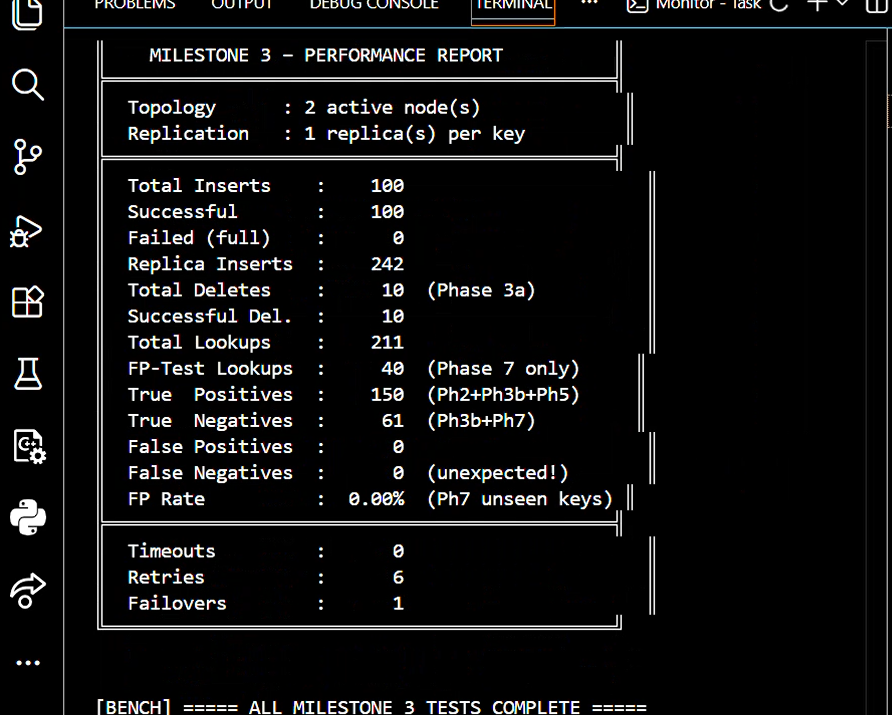
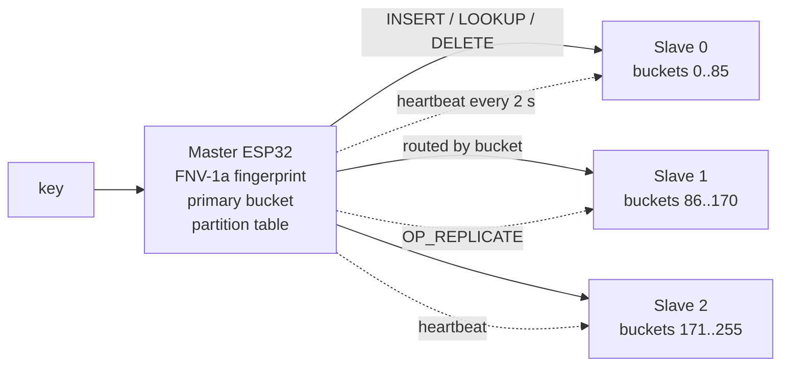

# Distributed Cuckoo Filter on ESP32 (ESP-NOW)

A Cuckoo Filter, the probabilistic set that supports **insert, lookup and delete**, split across a small cluster of ESP32 microcontrollers that talk to each other over **ESP-NOW**. There's no operating system and no shared memory, and each board has only 520 KB of SRAM.

A master board hashes every key and routes each operation to the slave that owns its bucket range. In the final milestone, every insert is also replicated to a second board, and the master runs heartbeats to detect a crashed node and fail over automatically.

> Parallel & Distributed Computing course project, IBA Karachi, Spring 2026. Team of four (see [Team](#team)).



## Results (Milestone 3 benchmark)

| Metric | Result |
|---|---|
| Inserts | **100 / 100** successful, 0 filter-full failures |
| Deletes | **10 / 10** successful |
| Lookups | 211 total: **150 true positives, 61 true negatives** |
| False positives | **0** (0.00% on unseen keys, threshold < 3%) |
| False negatives | **0** |
| Timeouts / retries | 0 timeouts, 6 retries (all succeeded on the next attempt) |
| Failover | 1 simulated node crash, detected and recovered automatically with no data loss |

| Operation | Latency |
|---|---|
| INSERT (with replication) | ~57 ms avg |
| DELETE | ~52 ms avg |
| LOOKUP, same partition | ~47–57 ms |
| LOOKUP, cross-partition (REMOTE_CHECK) | ~90–110 ms |
| Heartbeat round trip | ~18–22 ms |

Milestone 1 (single node) reached a **92.2% load factor** (944 / 1024 slots) with a 0.00% false-positive rate over 1,000 queries for absent keys.

## How it works



- **Fingerprints and buckets.** The master computes a 16-bit FNV-1a fingerprint and a primary bucket (0–255) for each key. The alternate bucket is `primary XOR hash(fingerprint)`, so either bucket can be computed from the other.
- **Hash-based partitioning.** The 256 buckets are split into contiguous ranges, one per active slave, and pushed to the slaves with `OP_REBALANCE`. Slaves never re-hash keys or look up routes.
- **Cross-partition cuckoo kicks.** If a kick-out displaces a fingerprint whose other bucket lives on a different board, the slave replies `STATUS_FORWARD_INSERT` and the master re-routes it.
- **Cross-partition lookups.** If a fingerprint isn't in the local bucket and its alternate bucket is remote, the slave replies `STATUS_REMOTE_CHECK` and the master asks the other board.
- **Dynamic membership.** `addNode()` and `removeNode()` recompute the partition map, and `OP_DRAIN` moves fingerprints slave-to-slave before ownership changes.
- **Reliability.** A pending-request ring buffer re-sends anything unanswered after 3 s, up to 3 times.
- **Replication (M3).** Every insert is mirrored to a second slave with `OP_REPLICATE`, which is fire-and-forget, so the system is eventually consistent.
- **Failure detection (M3).** The master pings every slave every 2 s. After 3 missed replies it marks the node failed, remaps partitions, runs a repair sweep and checks consistency with `OP_SYNC`.

Every message is a single 38-byte packed `FilterMessage` struct, which fits well within ESP-NOW's 250-byte payload limit.

## Repository layout

```
firmware/
  milestone-2/
    master_node/master_node.ino     routing, partitioning, add/remove node, retries, 6-phase demo + test harness
    slave_node/slave_node.ino       partition-aware insert / lookup / delete, rebalance, drain
  milestone-3/
    cuckoo_m3_master/cuckoo_m3_master.ino   replication, heartbeats, failover, 7-phase benchmark
docs/images/                        serial-monitor captures from the M3 run
```

## Running it

**You need:** 2–4 ESP32 dev boards (WROOM-32 or similar) and Arduino IDE 2.x with **esp32 by Espressif Systems** v3.x installed from the Boards Manager.

1. Open `slave_node.ino`, set `THIS_NODE_ID` (0, 1 or 2) and flash each slave. Copy the MAC address each one prints at 115200 baud.
2. Paste the slave MACs into the `slaves[]` table in the master sketch, then flash the master and copy its MAC.
3. Put the master's MAC in `masterMacAddress[]` in the slave sketch and re-flash the slaves.
4. Open the master's Serial Monitor. The demo phases and benchmark start automatically.

Only two USB data ports? Once a board has been flashed, it only needs power, so a phone charger is enough to run the third node.

## Team

| Member | Contributions |
|---|---|
| **Aiman Gul Sabir** | **M1:** the single-node Cuckoo Filter (hash functions, bucket structure, kick-out mechanism) and insert/delete/lookup validation. **M2:** slave-side `handleInsert()` with cross-partition kick-out, `handleDelete()`, `handleLookup()` with REMOTE_CHECK, `handleDrain()` and the rebalance handler. **M3:** `OP_REPLICATE` handler, idempotent replica inserts, `handleSync()`, and filter state sync after a node rejoins. |
| Areesha Fasih | Master–slave architecture and routing, message format, partitioning strategy, add/remove node, replication strategy and recovery workflow. |
| Saad Khan | Test harnesses, false-positive measurement, latency tracking, TP/TN/FP/FN classification and the M3 benchmark report. |
| Ramis Kamlani | ESP-NOW communication layer, pending-request ring buffer, retry/timeout, REMOTE_CHECK resolution, heartbeat failure detection and crash simulation. |

## Limitations and next steps

- Replication is asynchronous, so consistency is eventual rather than strong. Two-phase commit would fix this at roughly 1.5–2× insert latency.
- Fingerprints live in SRAM and are lost on power-off. Checkpointing to NVS would let them survive reboots.
- Slave MACs are pasted in by hand. ESP-NOW broadcast discovery would remove that step.
- The design allows up to 8 nodes but has only been tested on real hardware with 3.

## References

- B. Fan, D. G. Andersen, M. Kaminsky, M. Mitzenmacher. *Cuckoo Filter: Practically Better Than Bloom.* ACM CoNEXT 2014.
- R. Pagh, F. F. Rodler. *Cuckoo Hashing.* Journal of Algorithms, 2004.
- Espressif. [ESP-NOW programming guide](https://docs.espressif.com/projects/esp-idf/en/latest/esp32/api-reference/network/esp_now.html).
